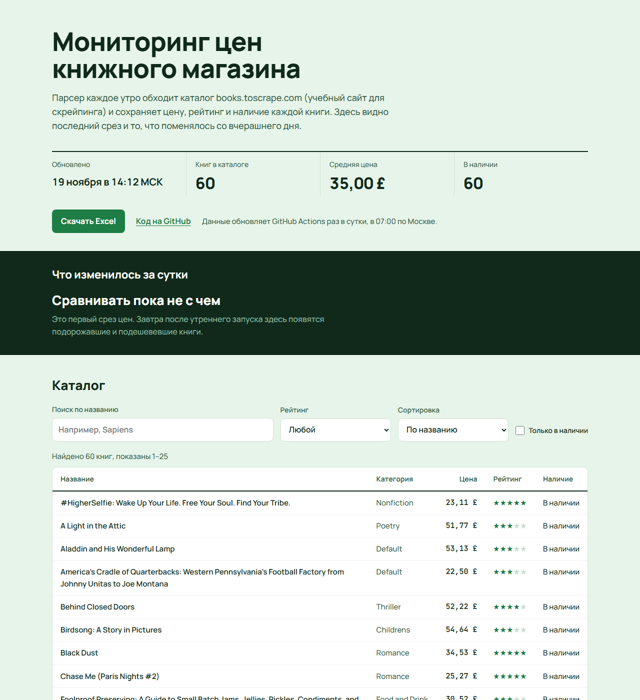

# Мониторинг цен книжного магазина

Учебный проект: парсер каждое утро собирает цены, рейтинг и наличие всех 1000 книг с [books.toscrape.com](https://books.toscrape.com) (песочница для практики скрейпинга), сравнивает их со вчерашним срезом и выкладывает результат на страницу с таблицей.

Живая страница: https://xevorin.github.io/price-monitor/



## Что делает

- Обходит 50 страниц каталога и 50 категорий, по каждой книге сохраняет название, цену в фунтах, наличие, рейтинг от 1 до 5, категорию и ссылку.
- Пишет срез в `data/latest.json`, копию в `data/history/ГГГГ-ММ-ДД.json` и таблицу Excel в `data/latest.xlsx`.
- Сравнивает срез с предыдущим днём и пишет `data/changes.json`: новые книги, пропавшие книги и изменения цен с разницей в фунтах.
- На странице: поиск по названию, фильтры по рейтингу и наличию, сортировка по цене, рейтингу и названию, по 25 книг на страницу, блок изменений за сутки и ссылка на Excel.

Цены на books.toscrape.com не меняются, поэтому блок изменений почти всегда пишет «Цены за сутки не изменились». Код сравнения покрыт тестами на искусственных данных.

## Стек

- Python 3.12, httpx, BeautifulSoup4, openpyxl
- pytest, тесты на сохранённых HTML-страницах в `tests/fixtures/`
- GitHub Actions для ежедневного запуска
- GitHub Pages и чистый HTML, CSS и JavaScript без сборки

Парсер ведёт себя вежливо: пауза 0,5 с между запросами, свой User-Agent `price-monitor-study/1.0`, три попытки при ошибке сети. Категории он берёт из страниц категорий, а не из карточек книг: так выходит около 70 запросов вместо 1000.

## Как запустить

```bash
python -m venv .venv
.venv\Scripts\activate        # Windows; на Linux и macOS: source .venv/bin/activate
pip install -r requirements.txt

python -m pytest              # тесты
python -m scraper.run --pages 3   # 3 страницы каталога, 60 книг
python -m scraper.run             # весь каталог, около 2 минут
```

Флаг `--no-categories` пропускает сбор категорий.

Страница читает JSON через `fetch`, поэтому с `file://` она не откроется. Запустите локальный сервер:

```bash
python -m http.server 8765
```

и откройте http://localhost:8765/.

## Как работает расписание

Workflow `.github/workflows/scrape.yml` стартует каждый день в 04:00 UTC (07:00 по Москве), его можно запустить и вручную на вкладке Actions. Он ставит Python 3.12 и зависимости, прогоняет тесты, собирает весь каталог и коммитит папку `data/` от имени `github-actions[bot]`, если файлы изменились. GitHub Pages раздаёт страницу из корня ветки `main`, так что после коммита дашборд показывает свежий срез.

## Структура

```
scraper/parse.py     разбор HTML и сравнение срезов, без сети
scraper/run.py       CLI: загрузка страниц, запись JSON и Excel
tests/               тесты и сохранённые страницы
data/                результаты, их обновляет workflow
index.html, app.js, style.css   дашборд
```

---

Учебный проект · Егор Фарафонов · [профиль на FL.ru](https://www.fl.ru/users/farafonovegor07/)
